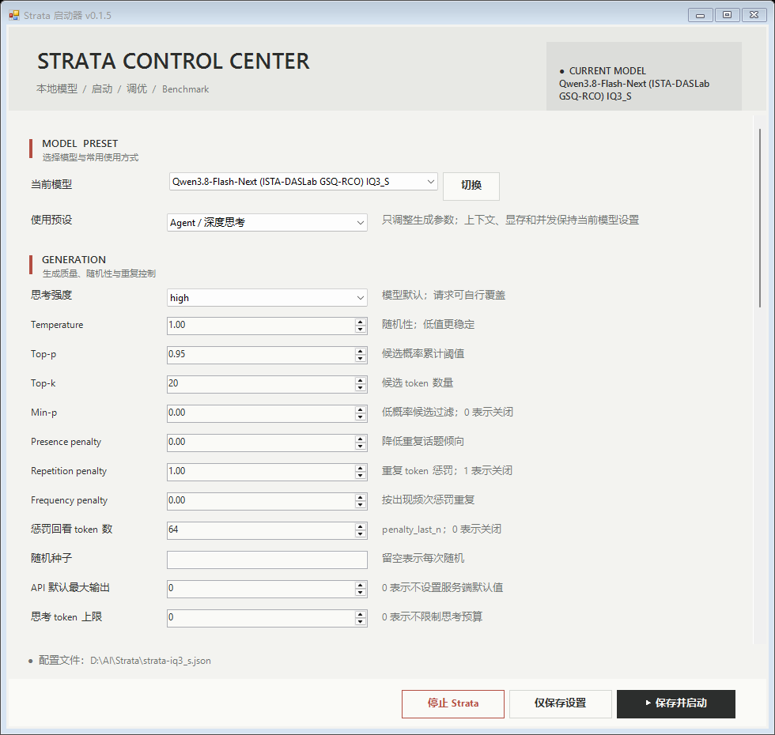
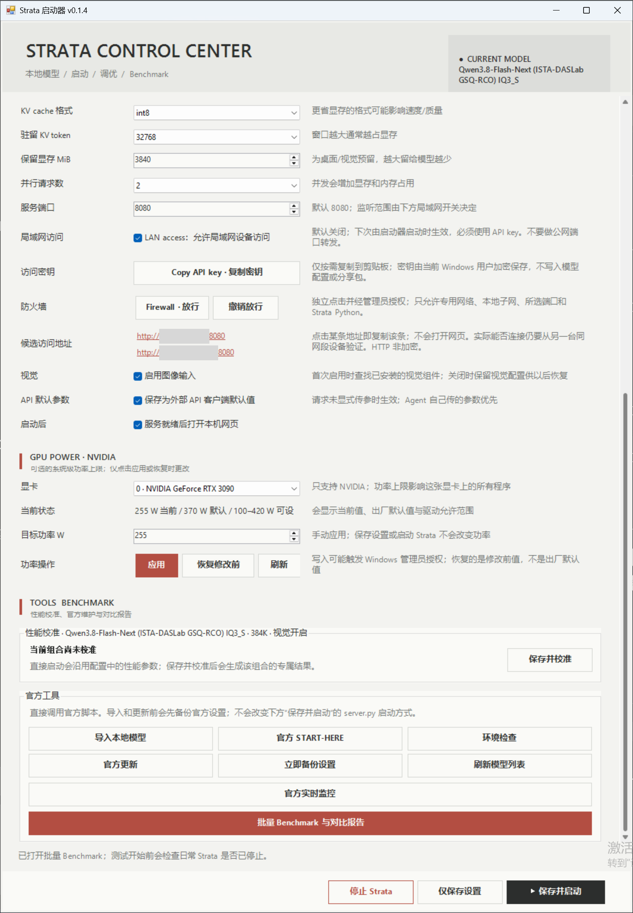
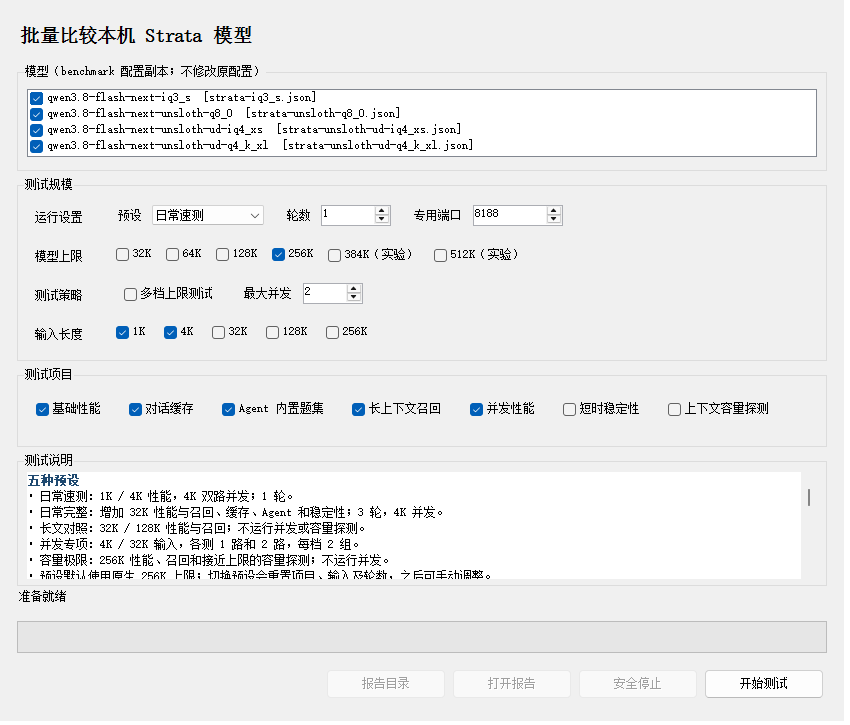

# Strata Launcher

**为已经安装 Strata 的 Windows 用户提供图形化启动、模型设置和批量 Benchmark。**

最新正式版：**v0.1.7.5** · 针对 **Strata v0.2.4.2 / 引擎 0.1.48 / DeepSeek 0.1.49.2** 完成校验 · [安装包下载](https://github.com/XTTGO/Strata-Launcher/releases/tag/v0.1.7.5)

v0.1.7.5 完成 DeepSeek-V4.1-Flash 的完整接入：导入、按引擎保存参数、多卡与 `--tp`、官方调优与规划预测、上下文 8K–1M；与 Qwen 共用启动器，按当前模型自动切换规则。DeepSeek 下 Qwen 口径的批量 Benchmark、视觉与并行请求已禁用并说明原因。

> 启动器依赖已有的 Strata 安装。打包版不包含模型、Strata 引擎或 Python 环境；官方 App 和独立 Terminal 的安装方式暂不支持。

## 界面预览

### 主界面

选择模型、调整生成参数并保存设置，或从同一窗口启动 Strata。



<sub>v0.1.5 实际界面截图。图中的模型名称和配置路径来自截图电脑，不随启动器分发。</sub>

### 运行设置与工具

在主界面下方设置局域网访问和 NVIDIA 显卡功率，并打开 Strata 官方工具。



<sub>v0.1.4 实际界面截图；两处局域网 IP 地址已遮盖。v0.1.5 的界面以程序实际显示为准。</sub>

### 批量 Benchmark

选择模型、预设、上下文上限和测试项目；运行后可查看本机生成的对比报告。



<sub>v0.1.5 实际界面截图。截图仅展示测试设置，没有启动 Benchmark。</sub>

## 快速开始

1. 在 Windows 10 或 11 上，通过 Strata 的 `START-HERE.bat` 完成源码安装，并安装至少一个模型。
2. 从 [v0.1.7.5 Release](https://github.com/XTTGO/Strata-Launcher/releases/tag/v0.1.7.5) 下载 `Strata-Launcher-v0.1.7.5-for-existing-install.zip`。
3. 解压后，将整个 `launcher` 文件夹放进 Strata 根目录，与 `START-HERE.bat` 并列。
4. 双击 `launcher\Strata-Launcher.bat`。

```text
<Strata 根目录>\
├─ START-HERE.bat
├─ serve\
├─ engine\
├─ strata-模型名.json
└─ launcher\
   └─ Strata-Launcher.bat
```

首次打开时会检查 Strata 目录、Python 环境、引擎和模型配置；缺少必需文件时会列出问题。

## 主要功能

- **模型与参数：**切换本机模型，调整生成参数、上下文、显存和视觉选项，并保留配置中未展示的字段。
- **模型列表刷新：**检查配置引用的 GGUF 和专家包；组件缺失时暂时隐藏该模型，保留官方配置，文件恢复后可再次刷新。
- **引擎版本检查：**官方预编译引擎对照 `setup.py` 的 `MIN_ENGINE` 兼容下限；本地编译引擎还对照源码构建目标。旧引擎显示警告并可继续启动，安装信息缺失时提示先检查更新。
- **官方更新：**有上游分支时快进更新；没有上游时跟随官方最新稳定 Release。随后运行官方安装更新；若预编译引擎低于兼容下限，再调用官方签名更新源，并核对 `BUILD.json` 与可执行文件版本。分支冲突会安全停止。
- **启动与管理：**保存设置后启动或停止本机 Strata；局域网访问和 NVIDIA 显卡功率设置均为可选操作。
- **批量 Benchmark：**按预设测试性能、缓存、Agent、长上下文召回和并发等项目；使用报告目录中的配置副本，不修改日常模型 JSON。
- **本机报告：**在 `launcher\reports` 保存 HTML 报告、原始结果和配置快照。

## 文档与验证

- [详细安装与功能说明](README.txt)
- [版本更新记录](CHANGELOG.md)
- [v0.1.7.5 发布说明与 SHA-256](releases/v0.1.7.5/RELEASE_NOTES.md)

v0.1.7.5 的发布验证记录见对应发布说明：139 个 Python 测试与 37 个 PowerShell 测试通过，DeepSeek 官方导入与冒烟测试通过；**启动器内的完整加载、长对话与停止未做完整验收。**
